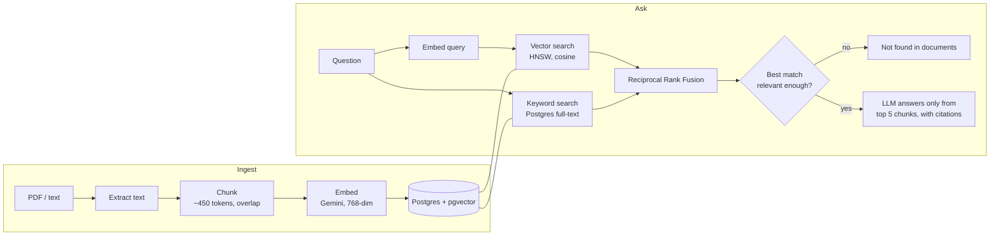

# Job Doc Q&A: a RAG assistant for job descriptions and resumes

Upload job descriptions or resumes (PDF, TXT, MD), then ask questions in plain English:
*"Which roles offer visa sponsorship?"*, *"What does the Laravel role require?"*.
Answers come **only** from the uploaded documents, with **numbered citations** to the exact passages,
and the app says so when the answer isn't there.

**Live demo:** _add your Vercel URL here_ · **API:** _add your Render URL here_
(free tier: the API sleeps when idle, so the first request can take ~40 seconds)

## How it works



1. **Ingest:** text is extracted, split into overlapping chunks, embedded, and stored in one transaction
   (embeddings are created *before* the transaction opens, so a slow AI call never holds database locks).
2. **Retrieve:** **hybrid search**. pgvector finds chunks with similar *meaning*, Postgres full-text finds
   *exact terms* (e.g. "Laravel 11", "Blue Card"), and the two rankings are merged with reciprocal rank fusion.
3. **Guardrail:** if even the best chunk is below a similarity threshold, the API returns "not found"
   without calling the LLM, so off-topic questions get no invented answer.
4. **Generate:** the LLM gets the top 5 chunks as numbered sources, with instructions to answer only from
   them and cite every claim.
5. **Evaluate:** `npm run eval` measures retrieval quality (hit@5, MRR) on a labelled question set and checks
   that off-topic questions stay under the threshold.

## Tech stack

| Layer | Choice |
|---|---|
| Frontend | React 18 + Vite + TypeScript (Vercel) |
| API | Node.js 20, Express, TypeScript, Zod validation (Render) |
| Vectors & search | PostgreSQL + pgvector (HNSW index) + full-text search (GIN index) |
| AI | Google Gemini: `gemini-embedding-001` for embeddings, `gemini-3.5-flash` for answers, behind an `AiProvider` interface |
| Quality | Vitest unit tests, retrieval evaluation script, GitHub Actions CI with `npm audit` |

## Run locally

Prerequisites: Node 20+, a Postgres database with pgvector (a free [Neon](https://neon.tech) project works),
and a free Gemini API key from [Google AI Studio](https://aistudio.google.com/apikey).

```bash
# API
cd server
cp .env.example .env        # fill in DATABASE_URL and GEMINI_API_KEY
npm install
npm run dev                 # http://localhost:4000, creates tables on first start
npm run seed                # optional: load 3 sample job descriptions
npm run eval                # optional: retrieval metrics

# Web (second terminal)
cd web
npm install
npm run dev                 # http://localhost:5173 (proxies /api to :4000)
```

## Deploy

1. **Database:** create a Neon project and copy the connection string (pgvector is available on Neon).
2. **API on Render:** New > Blueprint > select this repo (uses `render.yaml`). Set `DATABASE_URL`,
   `GEMINI_API_KEY`, and `CORS_ORIGIN` (your Vercel URL).
3. **Web on Vercel:** import the repo, set **Root Directory** to `web`, and add the environment variable
   `VITE_API_URL` = your Render URL. Deploy.
4. Run `npm run seed` locally against the production `DATABASE_URL` to load the demo documents.

## API

| Method | Path | Body | Purpose |
|---|---|---|---|
| GET | `/api/health` | | Liveness + DB check |
| GET | `/api/documents` | | List documents with chunk counts |
| POST | `/api/documents` | multipart `file`, or JSON `{ title, text }` | Ingest a document |
| DELETE | `/api/documents/:id` | | Delete a document and its chunks |
| POST | `/api/ask` | `{ question, documentIds? }` | Answer with sources and citations |

## Project layout

```
server/src/rag/       chunker, rank fusion, prompt + citation parsing (pure, unit-tested)
server/src/ai/        AiProvider interface + Gemini implementation (REST, retries with backoff)
server/src/services/  extract, ingest, retrieve (hybrid), answer (guardrail + generation)
server/scripts/       seed and evaluation
server/samples/       fictional job descriptions + labelled evaluation questions
web/src/              React UI
```

See [DECISIONS.md](DECISIONS.md) for the reasoning behind each design choice and what I'd do next.
